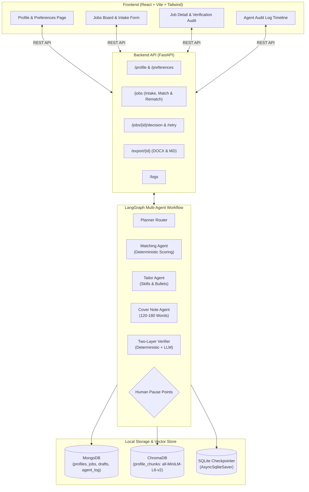

# Job-Search Copilot

A local, privacy-conscious multi-agent web application designed to help students prepare tailored internship applications under human supervision — **without ever fabricating experience** and **without ever sending anything automatically**.

> **Privacy Notice**: Vector embeddings run locally via `sentence-transformers/all-MiniLM-L6-v2` in ChromaDB so candidate vectors remain on your machine. However, resume text and job description text are transmitted to the configured LLM provider (Google Gemini API by default) for parsing, tailoring, and claim verification.

---

## Key Principles & Hard Invariants

1. **Zero Fabrication**: Tailoring only reorders and rephrases real candidate achievements. No new claims, tools, or metrics are ever added.
2. **Mandatory Human-in-the-Loop**: Applications are never auto-submitted. The system pauses at explicit approval checkpoints.
3. **Local Privacy**: Embeddings run locally via `sentence-transformers/all-MiniLM-L6-v2` in ChromaDB so candidate experience vectors never leave your device.
4. **SSRF & Injection Hardened**: Multi-hop DNS validation blocks private/internal network access, while prompt delimiters isolate untrusted JD text.
5. **Two-Layer Verification**: Every draft must pass Layer 1 (deterministic regex and metric verification) and Layer 2 (LLM claim validation) before approval.

---

## System Architecture



---

## Quickstart Options

### Option 1: Full Stack via Docker Compose (Recommended)

Start MongoDB, FastAPI backend, and Nginx-served React frontend in one command:

```bash
# 1. Configure environment variables
cp .env.example .env
# Edit .env and supply your GEMINI_API_KEY

# 2. Build and launch all services
docker compose up -d

# 3. Access the application:
# Frontend Web UI: http://localhost:3000
# Backend API Docs: http://localhost:8000/docs
# Health Check:     http://localhost:8000/health
```

To stop:
```bash
docker compose down
```

---

### Option 2: Local Development

#### 1. Backend Setup
```bash
# Create and activate Python 3.11 virtual environment
python -m venv .venv

# Windows:
.\.venv\Scripts\activate
# macOS/Linux:
source .venv/bin/activate

# Install dependencies
pip install -r backend/requirements.txt

# Start local MongoDB (via Docker)
docker compose up -d mongodb

# Start FastAPI server
uvicorn backend.main:app --reload --host 0.0.0.0 --port 8000
```

#### 2. Frontend Setup
```bash
cd frontend
npm install
npm run dev
# Vite dev server starts at http://localhost:5173
```

---

## 3-Minute Evaluator Demo Script

Follow this script to verify the complete end-to-end workflow in 3 minutes:

### Step 1: Upload Profile & Set Preferences (30 seconds)
1. Open the UI at `http://localhost:3000` (or `http://localhost:5173`).
2. Navigate to the **Profile & Preferences** tab.
3. Drag and drop the synthetic test resume fixture from `backend/tests/fixtures/sample_resume.pdf`.
4. Observe the candidate details populated: *Alex Chen (B.S. Computer Science, State University of Technology, GPA 3.85)*.
5. In **Preferences**, set Target Roles: `Software Engineer Intern`, Max Duration: `6 months`, Preferred Location: `Austin, TX`, Emphasise: `Python, React`, Avoid: `PHP`.
6. Click **Save Preferences**.

### Step 2: Intake a Job Posting (30 seconds)
1. Switch to the **Jobs Board** tab.
2. In the **Add Opportunity** section, paste the contents of `backend/tests/fixtures/jd_strong_match.txt` (or enter a public URL).
3. Click **Submit Job**.
4. The opportunity will appear on the table with status `processing` and automatically transition to `awaiting_approval` or `approved`.

### Step 3: Review Match Score Breakdown (30 seconds)
1. Click **View Details** on the job row.
2. Review the deterministic score breakdown:
   - **Required Skills Coverage**: ~50% weight (Python, React matched).
   - **Semantic Similarity**: ~30% weight (calibrated cosine similarity against profile chunks).
   - **Preference Fit**: ~20% weight (location, duration, and avoid-skills verified).
   - **LLM Reasoning**: Clear explanation of strengths and candidate gaps.

### Step 4: Inspect Tailoring & Two-Layer Verifier Audit (45 seconds)
1. In the **Tailored Application Materials** section:
   - View **Tailored Skills**: Emphasises Python, React, FastAPI without inventing unearned skills.
   - View **Project Highlights**: Exact project titles from candidate history with action-oriented bullets.
   - View **Cover Note**: Concise, factual letter strictly within 120-180 words.
2. Review the **Verifier Audit**:
   - Status: `Passed: Zero Hallucinations Detected`.
   - Layer 1 (Deterministic) and Layer 2 (LLM) quote verification.

### Step 5: Decision Interrupt & Export (15 seconds)
1. On the **Decision Action Bar**, click **Approve Application**.
2. Notice status changes to `approved`.
3. In the export bar, click **Export DOCX** or **Export Markdown**.
4. Open the downloaded file to verify cleanly formatted headings, bullets, and cover note.

---

## Automated Evaluation & Benchmarks

Run the evaluation suite measuring match accuracy and hallucination catch rates:

```bash
# Run evaluation smoke test benchmark
python backend/eval/run_eval.py --allow-small
```

> **Evaluation Honesty Notice**: Benchmark numbers in `eval_report.md` reflect a small synthetic smoke test ($n=6$) with author-written ground truth labels, intended for regression testing rather than empirical statistical proof. See [`eval_report.md`](file:///c:/Users/dharr/OneDrive/Documents/Desktop/Job-Search%20Copilot/eval_report.md) for detailed analysis.

---

## Test Suite Execution

```bash
# Run fast test suite (71 tests in < 60s)
pytest -v -m "not slow"

# Run integration tests including local sentence-transformers model
pytest -v -m slow

# Run full test suite (73 tests)
pytest -v
```

---

## Detailed Documentation & Guides

- [System Architecture & Specifications](docs/ARCHITECTURE.md): Deep-dive into state machines, verification layers, database schema, and security models.
- [3-Minute Evaluator Demo Script](docs/DEMO_SCRIPT.md): Step-by-step walkthrough using synthetic test fixtures.
- [Project Evaluation & Technical Interview Guide](docs/PROJECT_EVALUATION_AND_INTERVIEW_GUIDE.md): 6 core goals acceptance table, 5 weakest points explained, and 8 technical interview Q&As.
- [Evaluation Benchmark Report](eval_report.md): Automatically generated benchmark results from `backend/eval/run_eval.py`.
- [Final Cross-Phase Checklist](docs/FINAL_CHECKLIST.md): Complete audit of all phases with PASS / FAIL / NOT VERIFIED status and real command evidence.

---

## What Is Not Built (Out of Scope & Future Work)

To maintain absolute security, privacy, and compliance with our hard invariants, the following features are intentionally **not** implemented:

1. **Automated Application Submission**: The application will never automatically submit job applications, fill external web forms, or dispatch emails on the candidate's behalf. All preparation stops at user-approved drafts for human copy-pasting or export.
2. **Login-Gated Web Scraping**: The intake pipeline does not scrape LinkedIn, Glassdoor, Workday, or any site behind authentication walls. Only public URLs or pasted job description text are accepted.
3. **Headless Browsers**: The scraper uses `httpx` + `readability` + `BeautifulSoup4` with SSRF protections. No Chromium/Puppeteer/Playwright instances are spawned.
4. **Cloud Multi-Tenancy**: The current backend is designed for a single student running locally. State checkpoints use SQLite (`checkpoints.db`) rather than a distributed Redis or PostgreSQL instance.
5. **Resume Generation from Scratch**: The system cannot generate a resume for a candidate with no prior experience. It strictly reorders, highlights, and formats real achievements provided in the base profile.

---

## Repository Layout

```
.
├── backend/
│   ├── agents/            # Multi-agent implementations (intake, matching, tailor, cover note, verifier)
│   ├── api/               # FastAPI route modules (profile, preferences, jobs, export, logs)
│   ├── eval/              # Evaluation benchmarks and data (eval_matcher.py, eval_verifier.py, run_eval.py)
│   ├── llm/               # Provider-agnostic LLM client wrapper (Gemini default)
│   ├── models/            # Pydantic data schemas (profile, job, draft, match, logs)
│   ├── prompts/           # External Markdown prompt templates
│   ├── tests/             # Pytest test suite mirroring backend architecture
│   ├── vector_store.py    # Local ChromaDB vector store client
│   └── workflow/          # LangGraph graph definition, state transitions, checkpointer, and runner
├── data/
│   ├── jds/               # Evaluation benchmark JDs (sample_01 to sample_06)
│   └── labels.csv         # Ground-truth fit labels and ranks
├── frontend/
│   ├── src/               # React 18 UI components, pages, and API client
│   ├── nginx.conf         # Production Nginx reverse-proxy configuration
│   └── Dockerfile         # Multi-stage production container build
├── eval_report.md         # Auto-generated benchmark report from real numbers
├── docker-compose.yml     # Multi-container orchestration (MongoDB, backend, frontend)
└── README.md
```
