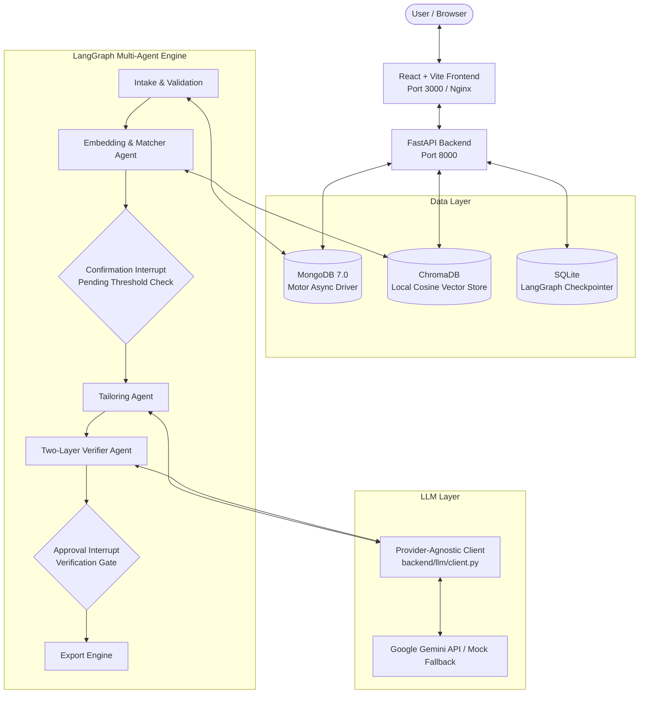
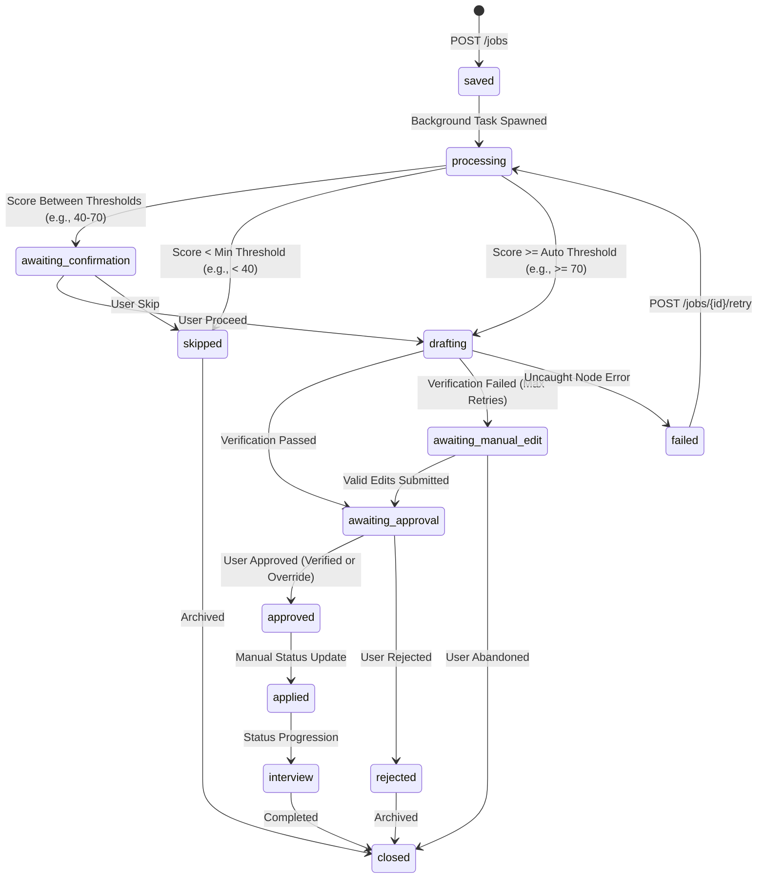
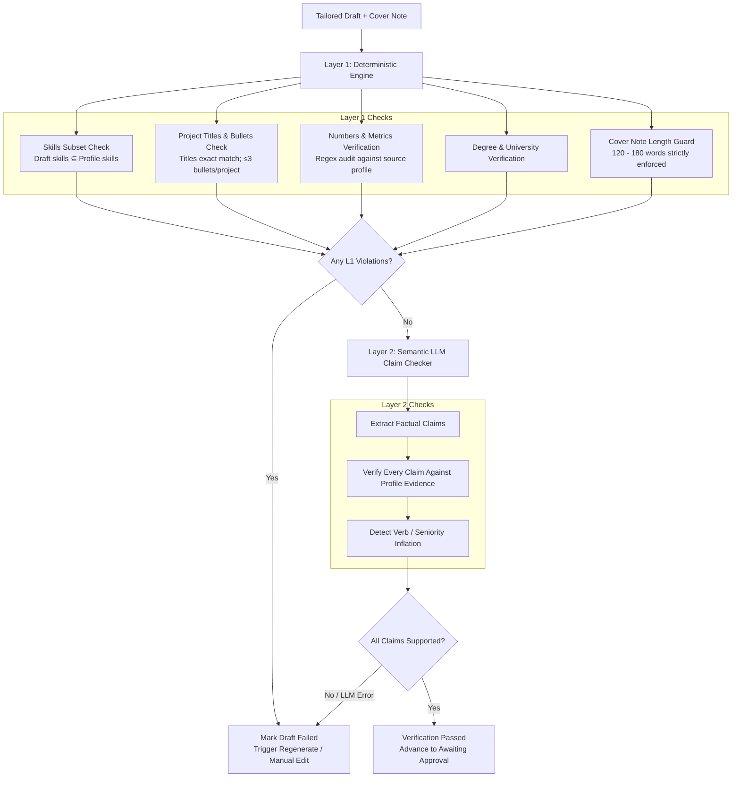

# System Architecture & Technical Specifications

Job-Search Copilot is a local-first, multi-agent AI assistant designed to prepare high-quality, verified software internship applications while eliminating LLM hallucinations and preserving complete human control.



---

## 1. Core Architectural Principles

1. **Anti-Hallucination Invariant**: The system never invents skills, experiences, degrees, employers, or project metrics. Tailoring only reorders, selects, and highlights genuine candidate facts.
2. **Mandatory Human-in-the-Loop**: No resume or cover letter is ever submitted or marked approved automatically. Applications pause at human checkpoints for review.
3. **Fail-Closed Verification**: If an LLM call fails during verification, the verification result defaults to `passed=False` with error flags. A draft can never reach `approved` status without passing verification or having an explicit human override recorded.
4. **Minimal Checkpoint State**: LangGraph checkpoints persist state across interrupts in SQLite. To prevent data staleness and duplication of personal data, `JobState` holds only identifiers, counters, and small status summaries. Large documents (Profile, Job description, full drafts) are persisted in MongoDB.

---

## 2. Multi-Agent Workflow State Machine

The orchestration engine is built on LangGraph with state persistence in SQLite (`checkpoints.db`) and atomic conditional status updates in MongoDB.



### Transition Integrity & Invariant Enforcement
All status transitions pass through a single centralized validator `apply_status_transition()` executing an atomic MongoDB conditional update:
```python
result = await collection.update_one(
    {"_id": job_id, "status": current_status},
    {"$set": {"status": next_status, "updated_at": now}}
)
```
- **Approval Invariant**: Transitioning to `approved` is strictly rejected (HTTP 409) unless the latest draft in MongoDB has `verification.passed == True` or `user_override == True`.
- **Export Invariant**: Generating markdown or plaintext exports (`GET /export/{id}`) is permitted only when status is `approved`, `applied`, `interview`, or `closed`.

---

## 3. Two-Layer Verification Architecture

Drafts produced by the Tailoring Agent are subjected to an adversarial two-layer verification pipeline before presentation to the user:



1. **Layer 1 (Deterministic)**:
   - Zero LLM latency, zero cost, completely deterministic.
   - Skill containment: Asserts every skill in `skills_section` exists verbatim in `profile.skills`.
   - Metric preservation: Extracts all numbers, percentages, and metrics (`\b\d+(?:[.,]\d+)*%?`) and confirms they exist in candidate source achievements.
   - Constraint gating: Checks that project count $\le 3$, bullet counts $\le 3$ per project, and cover note length is between 120 and 180 words.
2. **Layer 2 (Semantic LLM Check)**:
   - Extracts factual assertions and maps them to profile evidence.
   - Flags seniority inflation (e.g., student described as "Staff Architect" or "World-class authority").
   - **Fail-Closed Guarantee**: If the LLM call times out, returns HTTP 429/500, or provides unparseable output, Layer 2 returns `passed=False` with `reason="LLM verification layer unavailable - fail closed"`.

---

## 4. Security & Privacy Safeguards

- **Strict Localhost Binding**: All exposed network ports in Docker Compose bind exclusively to `127.0.0.1` (`127.0.0.1:8000`, `127.0.0.1:3000`, `127.0.0.1:27017`).
- **SSRF Defense Engine**: Public JD URL fetching verifies target host DNS resolutions, explicitly rejecting private IPv4 (10.0.0.0/8, 172.16.0.0/12, 192.168.0.0/16, 127.0.0.0/8), IPv4-mapped IPv6, and link-local ranges, with manual redirect following up to 3 hops and 2 MB streaming limits.
- **Privacy in Observability**: Agent logs record token counts, step names, and validation statuses. Full resume text, job description bodies, and raw API keys are strictly excluded from logs.
- **Provider-Agnostic LLM Isolation**: All generative inference flows through `backend/llm/client.py` with automatic exponential backoff retry for rate limits.

